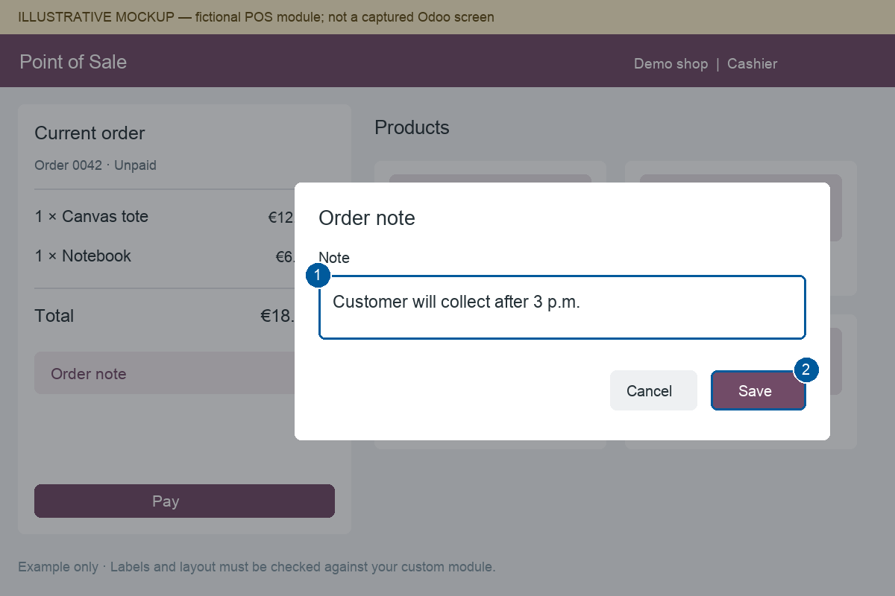

# Odoo knowledge writing doc

[](https://github.com/sleepingcat4/odoo-knowledge-writing-doc/actions/workflows/validate.yml)
[](LICENSE)

Turn a custom Odoo module into a clear guide for the people who use it.

An agent skill for writing task-based user and administrator documentation, informed by Apple and Adobe writing guidance. Point your agent to a module, name the audience, and get plain-language procedures, useful explanations, and a plan for annotated screenshots.

## See an example

The [POS example](references/pos-example.md) demonstrates a cashier guide for a fictional order notes module, including annotated illustrations.



*Illustrative mockup. This is not a screenshot of a real Odoo module.*

## What the skill does

- Reads module code, views, security rules, frontend components, and relevant dependencies.
- Explains business tasks, prerequisites, meaningful field choices, and expected results.
- Keeps implementation details out of business guides unless requested.
- Defines screenshot capture, redaction, numbered callouts, captions, and alt text.
- Records source evidence and verification limits separately from the reader's guide.

It does not assume that a feature exists because it is common in Odoo. Source-only documentation remains a draft until its UI procedures are verified.

## Use with your agent

Keep `SKILL.md`, `references/`, and `assets/` together. The skill instructions do not require a particular agent vendor or runtime.

**Skill-capable environments:** Add the folder using the host's supported skill installation method. The entry point is [SKILL.md](SKILL.md). If the host accepts ZIP uploads, create an archive using the packaging command below.

**ChatGPT or Claude projects with reference files:** Supply `SKILL.md` and the supporting Markdown files as project knowledge, preserving relative paths where supported. Tell the agent to follow `SKILL.md`. This is an instruction-based fallback; uploading reference files does not necessarily register an installable skill. Features and upload support depend on your product and workspace.

The agent also needs access to the custom module, through local files, an uploaded archive, or a connected repository. A local path alone does not give a web-based agent access to your computer. Real screenshots require a suitable test instance and browser/capture tools.

### Example prompt

```text
Use odoo-knowledge-writing-doc to document
/path/to/custom_addons/my_module for business users.

Inspect the source and relevant dependencies first. Explain the main
workflows with clear steps and expected results. Include annotated
screenshots if a test instance is available; otherwise provide a capture
plan in separate author notes. Write the guide in Markdown.
```

For POS, replace the module path and specify “for cashiers.” See the [complete POS walkthrough](references/pos-example.md) for sample output.

### Expected deliverables

```text
docs/
├── user-guide.md
├── author-notes.md       # Evidence, verification limits, capture requests
└── images/              # Actual captured and annotated figures, if available
```

The skill follows an existing repository's documentation layout when present. It can work without screenshots and keeps capture requests separate from confirmed instructions.

## Files in this repository

| File | Purpose |
| --- | --- |
| [SKILL.md](SKILL.md) | Agent instructions and evidence-based workflow |
| [Writing conventions](references/writing-conventions.md) | Writing principles and Odoo terminology decisions |
| [Screenshot workflow](references/screenshots.md) | Capture, annotation, accessibility, and visual review |
| [POS example](references/pos-example.md) | Invocation, sample guide, and annotated mockups |
| [Guide template](assets/guide-template.md) | Starting structure for generated guides |

## Validate and package

Maintainer commands use Python 3 and the standard library only:

```sh
python3 scripts/validate.py
python3 scripts/package.py
```

The second command validates the repository and writes `dist/odoo-knowledge-writing-doc.zip`, with a single skill folder at the archive root. Build outputs are ignored by Git. A GitHub Actions workflow runs the same validation on pushes and pull requests. Portable archives include the validation and packaging scripts.

Validation checks the skill identity, required resources, local Markdown links, and PNG files. It does not verify Odoo behavior or guarantee that a host supports skill installation.

## Contribute

Keep guidance focused on clear documentation and verifiable module behavior. When changing a convention, include the reason and an example. Label fictional examples and UI mockups explicitly. Do not include customer data, credentials, or proprietary module source in examples or issues. Run validation before submitting a change.

## Sources and license

Writing principles draw from the [Apple Style Guide](https://help.apple.com/pdf/applestyleguide/en_US/apple-style-guide.pdf) and [Adobe Spectrum grammar and mechanics](https://spectrum.adobe.com/page/grammar-and-mechanics/). The repository contains an original synthesis, not copies of those guides. Screenshot production settings are conventions for this skill.

Original repository content is available under the [MIT license](LICENSE). Linked third-party materials and trademarks remain with their respective owners. This project is independent of Apple, Adobe, Odoo, OpenAI, and Anthropic.
