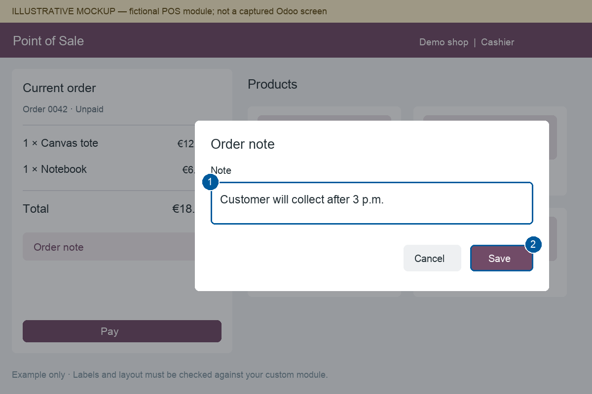
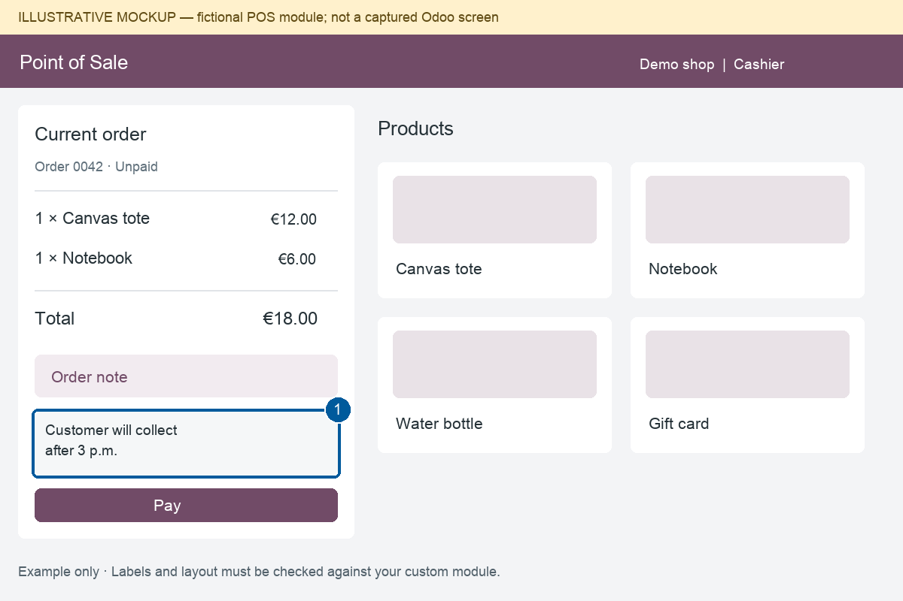

# Example: Document a custom POS module

This example uses a fictional module named `pos_order_note`. Its labels and behavior below are assumed solely to demonstrate the skill. No real module or running Odoo instance was inspected. An agent must verify these details against your module before publishing a guide.

## Prompt to give your agent

> Use odoo-knowledge-writing-doc to document `/path/to/custom_addons/pos_order_note` for cashiers. Explain how to add and edit an order note, where the note appears, and any restrictions. Inspect the module and relevant POS dependencies first. Write a simple Markdown guide with annotated screenshots if a test POS is available. If screenshots are unavailable, provide a capture plan in separate author notes. Keep developer details out of the cashier guide.

Replace the path with your custom module's actual location. Provide a test POS URL and suitable access if you want real screenshots and live verification.

## How the agent works

1. Reads the manifest to identify dependencies and version evidence.
2. Inspects POS frontend components, templates, model extensions, data-loading code, access controls, and tests. Checks whether notes apply to an order or an individual line, whether they persist, and whether they appear on receipts or kitchen tickets.
3. Confirms the actual button labels, available order states, role restrictions, and save behavior in code and, if available, the test UI.
4. Writes a task-based guide and captures only the screens that help cashiers understand the task.
5. Delivers the guide, available image files, and separate author notes with evidence and verification limits.

## Illustrative guide output

The following excerpt assumes the fictional module adds an **Order note** button, a **Note** field, and a **Save** button. It also assumes notes can be edited before payment and do not appear on receipts. These are example assumptions, not standard Odoo behavior.

---

# POS order notes guide

Add a note to an order to give your team useful context about the sale. The note stays with the order and does not appear on the customer's receipt.

## Before you begin

Your administrator must enable the order notes module. Open an unpaid order in your POS session.

## Add an order note

1. Select **Order note** in the current order.
2. Enter your message in **Note**. For example, enter “Customer will collect after 3 p.m.”
3. Select **Save**.

*Figure 1. Enter and save an order note. Illustrative mockup, not a captured Odoo screen.*

Callout 1 identifies **Note** in step 2. Callout 2 identifies **Save** in step 3.

The note appears on the current order. Check that the message is correct before taking payment.

*Figure 2. Check the saved note before taking payment. Illustrative mockup, not a captured Odoo screen.*

Callout 1 identifies the message to check after saving.

## Edit an order note

1. Open the unpaid order.
2. Select **Order note**.
3. Update the message in **Note**, then select **Save**.

The updated message replaces the previous note. You can edit the note until the order is paid.

---

## Illustrative author notes

For a real delivery, record source paths and symbols for the button, note storage, edit restriction, setup requirement, and receipt behavior. All five require verification; the excerpt above is a writing demonstration only.

The two figures above are annotated illustrations of the fictional module, not screenshots or evidence of real Odoo behavior. Replace them with real captures before publishing a guide for an actual module. A possible capture plan, to confirm against the real UI:

| Figure | Task | Capture | Annotation | Proposed filename |
| --- | --- | --- | --- | --- |
| 1 | Add an order note | Unpaid demo order with the note editor open | Badge 1 at **Note**; badge 2 at **Save** | `pos-order-note-01-editor.png` |
| 2 | Check the result | Same order after saving the example note | Rectangle around the visible saved note | `pos-order-note-02-saved.png` |

Place each actual image beside its relevant step or result, with a caption and descriptive alt text. Until the captures exist, keep this plan in author notes and omit image embeds from the guide.
